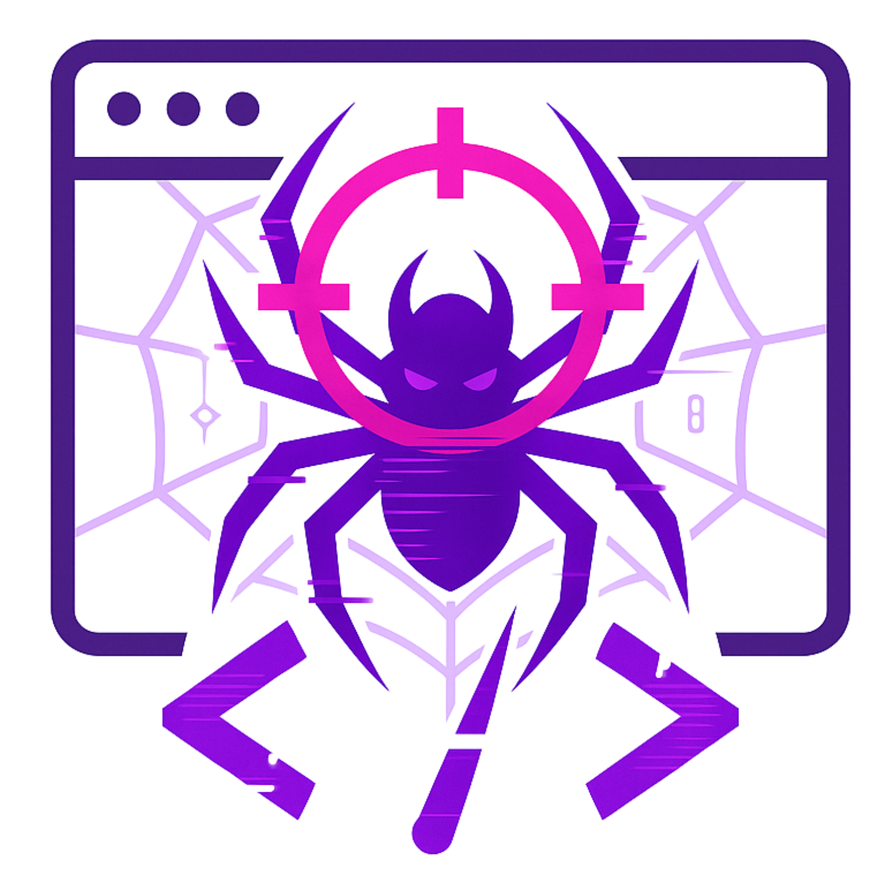
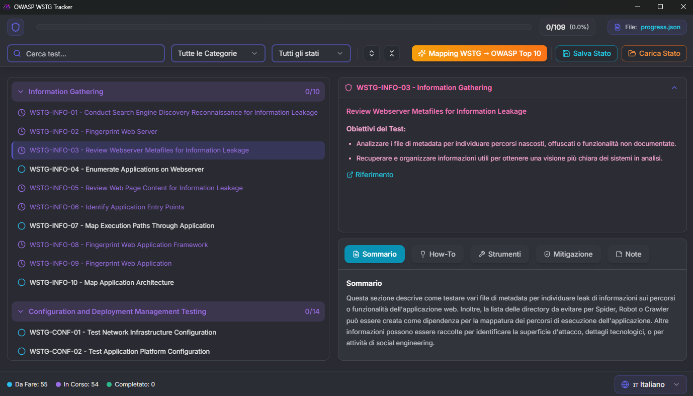

<p align="center">
  
</p>

<h1 align="center">OWASP WSTG Tracker</h1>

<p align="center">
  Desktop application to plan, track and document a web application security assessment<br>
  against the <a href="https://owasp.org/www-project-web-security-testing-guide/">OWASP Web Security Testing Guide</a>.
</p>

<p align="center">
  
  
  
  
  
</p>

## Contents

1. [What it is](#what-it-is)
2. [Quick start](#quick-start)
3. [Build and distribution](#build-and-distribution)
4. [Features](#features)
5. [Data format](#data-format)
6. [Configuration](#configuration)
7. [NPM scripts](#npm-scripts)
8. [License](#license)
9. [Disclaimer](#disclaimer)

## What it is

A web application assessment is a long list of checks, and the part that actually costs you time is not running them, it is keeping track of what has been covered, what is still open and what you found. OWASP WSTG Tracker turns the WSTG into a working checklist you can drive during an engagement.

The full guide ships with the app: **12 categories, 109 tests**, each with objectives, a how-to, suggested tools and remediation notes, in **English and Italian**. You set each test to *pending*, *in progress* or *done*, write your findings in a rich-text note attached to the test, and watch the completion counters move. Every WSTG category is mapped to the OWASP Top 10 entries it relates to, with a risk level, so the checklist doubles as a risk view.

Everything lives in a plain JSON file you own. There is no account, no telemetry and no backend: the app runs locally, saves next to the executable and reads back what you saved, so an assessment can be versioned, diffed and handed over like any other artifact.

Built with Electron, React and TypeScript. It also runs in the browser during development, with reduced functionality since file access goes through Electron.



## Quick start

### Prerequisites

- **Node.js** 20.19+ or 22.12+ (required by Vite 7)
- **npm** (bundled with Node.js)

### Install

```bash
git clone https://github.com/Alberto-00/OWASP_WSTG_Tracker.git
cd OWASP_WSTG_Tracker
npm install
```

### Run

```bash
npm run electron:dev    # desktop app, full functionality
npm run dev             # web only, http://localhost:8080, no file system access
```

## Build and distribution

```bash
npm run build           # optimized static build in dist/, also consumed by the desktop build
```

Each OS produces **its own target only**, cross compilation is not configured:

| Host | Command | Output |
|------|---------|--------|
| **Windows** | `npm run electron:build:win` | `release/OWASP WSTG Tracker-2.0.0-Portable.zip`, portable x64 folder, `logo_app.ico` embedded, pinnable to the taskbar |
| **Linux / WSL** | `npm run electron:build:linux` | `release/OWASP WSTG Tracker-2.0.0.AppImage`, x64, `logo_app.png` icon |
| Current OS | `npm run electron:build` | target of the OS in use |

## Features

### Checklist management

- 12 WSTG categories (Information Gathering, Configuration and Deployment Management, Identity Management, Authentication, Authorization, Session Management, Input Validation, Error Handling, Weak Cryptography, Business Logic, Client-side, API Testing)
- Search by test ID or name
- Filters by category and status
- Live counters and a completion progress bar
- Expand and collapse per category

### Test details

Each test carries the reference material you need while working on it:

- **Summary**, what the test covers
- **How-to**, step by step execution
- **Tools**, suggested tooling (Burp Suite, OWASP ZAP and others)
- **Remediation**, fix recommendations
- **Notes**, a rich-text editor for your own findings

### OWASP Top 10 mapping

- Every WSTG category is linked to the Top 10 entries it relates to
- Risk levels: critical, high, medium, low
- Per vulnerability descriptions with links to the OWASP references
- Interactive modal to navigate between WSTG and Top 10

### File handling

- Auto-save and auto-reload of the last file used
- Native save dialog to choose name and location
- Unsaved changes tracking, with a confirmation dialog before closing
- Readable JSON, easy to version and share
- Saves live in a `saves/` folder next to the app: on **Windows** inside the unzipped portable folder, next to `OWASP WSTG Tracker.exe`; on **Linux** next to the `.AppImage`. If that folder is not writable (for example under `Program Files`) it falls back to `%APPDATA%/owasp-wstg-tracker/saves`. In development it is `public/saves/`

### Bilingual

- English and Italian, Italian is the default
- Instant switch, no application reload
- Checklists, descriptions and UI are fully translated

### Note editor

- Bold, italic, underline, strikethrough
- H1, H2, H3 and paragraphs
- Bullet and numbered lists
- Inline code and code blocks
- Highlighting in 6 colours
- 5 text sizes
- Selective clear formatting

## Data format

Checklist content is split into four JSON files per language, under `public/json/<lang>/`.

### `checklist.json`

WSTG categories and their tests:

```json
{
  "categories": {
    "Information Gathering": {
      "id": "WSTG-INFO",
      "tests": [
        {
          "id": "WSTG-INFO-01",
          "name": "Conduct Search Engine Discovery Reconnaissance",
          "objectives": [
            "Identify what sensitive information is exposed",
            "Determine the attack surface"
          ],
          "reference": "https://owasp.org/..."
        }
      ]
    }
  }
}
```

### `category_descriptions.json`

One description per category:

```json
{
  "Information Gathering": "The initial phase consists of collecting..."
}
```

### `checklist_info_data.json`

Reference material per test, as HTML:

```json
{
  "WSTG-INFO-01": {
    "summary": "<p>HTML description...</p>",
    "how-to": "<p>HTML guide...</p>",
    "tools": "<ul><li>Tool 1</li></ul>",
    "remediation": "<p>Recommendations...</p>"
  }
}
```

### `owasp_top_10.json`

Mapping to the OWASP Top 10:

```json
{
  "A01:2021 - Broken Access Control": {
    "level": "alto",
    "description": "<p>Vulnerability description...</p>",
    "link": "https://owasp.org/..."
  }
}
```

`level` is one of `critico`, `alto`, `medio`, `basso` in both languages, the label is localized at render time.

### Progress file

The default is `public/json/progress.json`. User saves go to `saves/` next to the executable, or `public/saves/` in development:

```json
{
  "status": {
    "WSTG-INFO-01": "done",
    "WSTG-INFO-02": "in-progress",
    "WSTG-INFO-03": "pending"
  },
  "notes": {
    "WSTG-INFO-01": "<p>Formatted HTML notes...</p>"
  }
}
```

## Configuration

| File | What it holds |
|------|---------------|
| `package.json` | App metadata and the `build` block for electron-builder: app id `com.owasp.wstg.tracker`, output in `release/`, `public/` shipped as an extra resource, Windows zip target with `signAndEditExecutable` so the icon is embedded, Linux AppImage target |
| `vite.config.ts` | `base: './'` for relative paths under Electron, dev server on port 8080, output in `dist/`, `@` aliased to `src/` |
| `electron/main.js` | Main process: windows, IPC, file system access, `saves/` resolution |
| `electron/preload.js` | Context bridge exposing the file APIs to the renderer |

## NPM scripts

| Command | Description |
|---------|-------------|
| `npm run dev` | Vite dev server, web only |
| `npm run build` | Production web build |
| `npm run lint` | ESLint over the project |
| `npm run electron:dev` | Electron in development mode |
| `npm run electron:build` | Electron build for the current OS |
| `npm run electron:build:win` | Electron build for Windows |
| `npm run electron:build:linux` | Electron build for Linux |

## License

Licensed under the MIT License. See [LICENSE](LICENSE). The MIT license covers OWASP WSTG Tracker's own code only. The checklist content derives from the OWASP Web Security Testing Guide, which remains with the OWASP Foundation and its contributors under [CC BY-SA 4.0](https://creativecommons.org/licenses/by-sa/4.0/); the reference notes bundled with the app are reworked from that guide and from personal field experience. This project is not affiliated with or endorsed by the OWASP Foundation.

## Disclaimer

OWASP WSTG Tracker is a documentation and tracking tool for authorized security testing, training labs and CTFs. It tracks checklists and stores your notes, it does not test anything and does not run any command: what you execute against a target is on you.

Run security tests only against systems you own or that you have explicit written permission to test. Unauthorized access to computer systems and networks is a crime in most countries, and scanning or attacking third party infrastructure without a mandate can get you prosecuted regardless of intent.

The software comes with no warranty. The author takes no responsibility for damage, data loss, service disruption or legal consequences from using it. Your assessment data is stored locally in plain JSON: it usually contains sensitive findings about a client, so protect and dispose of those files accordingly.
