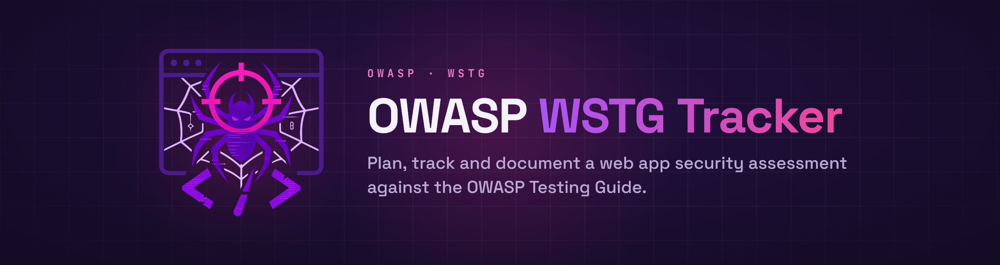
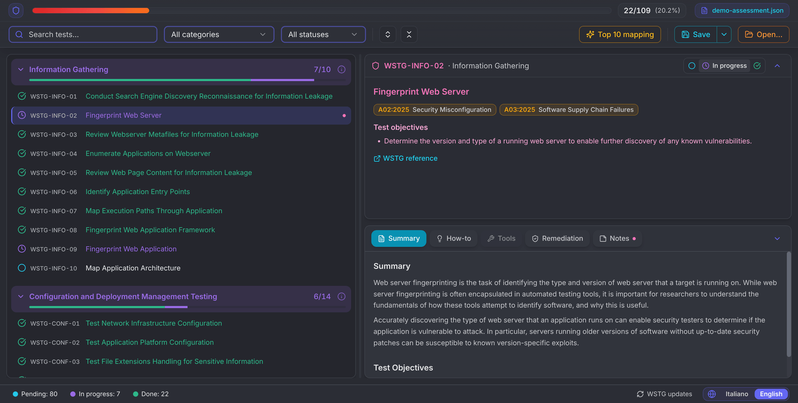
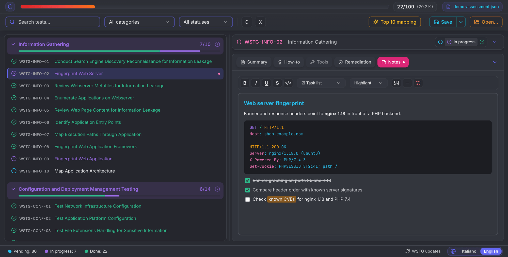
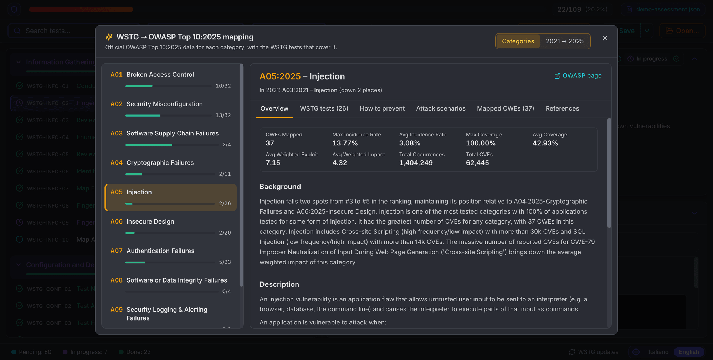
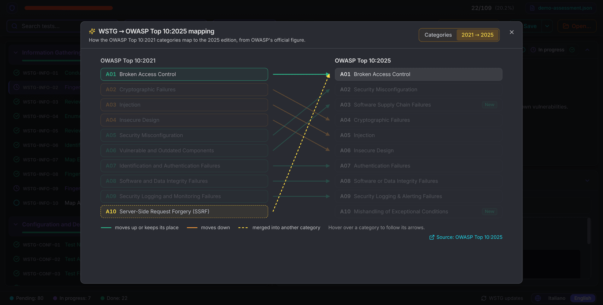

<p align="center">
  
</p>

<p align="center">
  <b>The full OWASP WSTG as a working checklist, with your findings and the OWASP Top 10:2025 one click away.</b>
</p>

<p align="center">
  <a href="https://github.com/Alberto-00/OWASP_WSTG_Tracker/releases/latest"></a>
  <a href="https://github.com/Alberto-00/OWASP_WSTG_Tracker/releases"></a>
  <a href="LICENSE"></a>
  
  <br>
  
  
  
  
  
  
</p>

<p align="center">
  <a href="#features">Features</a> •
  <a href="#screenshots">Screenshots</a> •
  <a href="#installation">Installation</a> •
  <a href="#usage">Usage</a> •
  <a href="#data-and-sources">Data and sources</a> •
  <a href="#development">Development</a> •
  <a href="#license">License</a> •
  <a href="#disclaimer">Disclaimer</a>
</p>

<p align="center">
  
</p>

A web application assessment is a long list of checks. What costs time is not running them, it is keeping track of what has been covered, what is still open and what you found along the way. **OWASP WSTG Tracker** turns the OWASP Web Security Testing Guide into a working checklist that you drive during an engagement: the full guide is in the app, you set the status of each test, write your findings next to it and always know where you stand, both on the WSTG and on the OWASP Top 10:2025.

It is a local desktop app. There is no account, no backend and no telemetry: an assessment is a plain JSON file that you own, version and hand over like any other deliverable.

| 109 | 12 | 10 | 2 | 0 |
|:---:|:---:|:---:|:---:|:---:|
| WSTG tests | WSTG categories | OWASP Top 10:2025 categories, with official data | languages, English and Italian | accounts, servers or trackers |

## Features

- **The whole WSTG checklist.** 109 tests in 12 categories, from Information Gathering to API Testing. Each test has its objectives, a summary, a step-by-step how-to, suggested tools and remediation, with a reference pinned to the exact WSTG version the checklist comes from.
- **Status tracking that keeps up with you.** Every test is *pending*, *in progress* or *done*. Overall and per-category progress bars, live counters, search by ID, name or objective, filters by category and status, keyboard navigation and bulk updates on multiple tests.
- **Findings notes on every test.** A rich-text editor built for pentest notes: headings, lists, task lists with checkboxes, highlights, links, quotes, inline code and code blocks with syntax highlighting for HTTP, Bash, JavaScript, JSON, HTML/XML, SQL, Python and PHP. Markdown shortcuts work as you type.
- **OWASP Top 10:2025 mapping.** Each WSTG test is linked to the Top 10:2025 categories of the weaknesses it can uncover, based on the CWEs OWASP assigns to each category. For every category you get the official OWASP data (score table, background, description, how to prevent, attack scenarios, references and mapped CWEs) and the coverage of its WSTG tests.
- **2021 → 2025 at a glance.** An interactive version of OWASP's official mapping figure: hover over a category to follow where it came from or where it went.
- **Your data stays a file.** Save, Save as and Open with native dialogs, atomic writes that cannot corrupt an existing assessment, a warning before losing unsaved changes, validation of every file you open, and the last assessment reopened at startup.
- **WSTG release check.** One click tells you whether OWASP has published a new official WSTG release; if so, the app downloads it next to your saves, ready to be integrated.
- **Bilingual.** English and Italian, switched on the fly. Test and category names stay in English, as in the official WSTG.

## Screenshots

<table>
  <tr>
    <td width="50%" valign="top">
      
      <p align="center"><sub><b>Findings notes</b>: HTTP highlighted, task list, highlights</sub></p>
    </td>
    <td width="50%" valign="top">
      
      <p align="center"><sub><b>OWASP Top 10:2025</b>: official data and coverage per category</sub></p>
    </td>
  </tr>
  <tr>
    <td colspan="2">
      
      <p align="center"><sub><b>2021 → 2025</b>: the official OWASP mapping, here following the two categories that flow into A01:2025</sub></p>
    </td>
  </tr>
</table>

## Installation

### Download

Get the latest Windows build from the [**Releases**](https://github.com/Alberto-00/OWASP_WSTG_Tracker/releases/latest) page. The app is portable: no installer and no admin rights are needed. If you downloaded the `.zip`, unzip it anywhere and run `OWASP WSTG Tracker.exe`. Your assessments are saved in the `saves` folder next to the executable.

### Build from source

Requirements: **Node.js** 20.19+ or 22.12+ and **npm**.

```bash
git clone https://github.com/Alberto-00/OWASP_WSTG_Tracker.git
cd OWASP_WSTG_Tracker
npm install
npm run electron:build:win
```

Each OS builds its own target only, there is no cross compilation:

| Host | Command | Output in `release/` |
|------|---------|----------------------|
| Windows | `npm run electron:build:win` | `OWASP WSTG Tracker-2.0.0-Portable.zip`, a portable x64 folder with the icon embedded in the `.exe` |
| Linux | `npm run electron:build:linux` | `OWASP WSTG Tracker-2.0.0.AppImage`, x64 |

## Usage

1. **Start an assessment.** The app reopens the last file you used. For a new engagement, use **Save as** (`Ctrl+Shift+S`) to create its file.
2. **Work through the checklist.** Pick a test to read its objectives, summary, how-to, tools and remediation. Click a category for its description, or use its **i** button to read it without opening or closing the category.
3. **Track progress.** Set the status from the detail header, by clicking the status icon in the list, with `Space`, or with a right click on several selected tests.
4. **Write your findings** in the **Notes** tab of each test. A pink dot marks the tests that have notes.
5. **Check the risk view.** Open **Top 10 mapping** to see, for each OWASP Top 10:2025 category, the official OWASP data and how many of its WSTG tests are done. A click on a test brings you back to it.
6. **Save** with `Ctrl+S`. The JSON file is your deliverable: keep it under version control, diff it or hand it over.

### Keyboard shortcuts

| Shortcut | Action |
|----------|--------|
| `Ctrl+S` | Save |
| `Ctrl+Shift+S` | Save as |
| `Ctrl+O` | Open an assessment |
| `Ctrl+F` | Search tests, `Esc` clears the search |
| `↑` `↓` `Home` `End` | Move between tests in the list |
| `Space` | Change the status of the focused test (pending → in progress → done) |
| `Ctrl+click`, `Shift+click` | Select several tests, then right click to set their status |
| `Ctrl+B` `Ctrl+I` `Ctrl+U` `Ctrl+E` | Bold, italic, underline, inline code in notes |
| `#` `-` `1.` `[ ]` `>` ` ``` ` followed by a space | Heading, bullet list, numbered list, task, quote, code block in notes |
| `Esc` or `Ctrl+Enter` | Leave a code block in notes |

## Data and sources

| Content | Source |
|---------|--------|
| WSTG tests, objectives and reference material | [OWASP Web Security Testing Guide](https://github.com/OWASP/wstg), pinned to commit [`d69a4842`](https://github.com/OWASP/wstg/tree/d69a4842ba51e95496294d2817fd3b920ea3cc69) (January 2026). English generated from the guide's markdown; Italian translated and reworked by the author |
| OWASP Top 10:2025 | The official pages at [top10.owasp.org](https://top10.owasp.org/2025/), English and the official Italian translation, imported by `npm run import:top10` from [`OWASP/Top10`](https://github.com/OWASP/Top10) at a pinned commit. The CWE lists come from the English pages in both languages, because the Italian ones are incomplete for a few categories |
| Mapping WSTG → Top 10:2025 | `src/lib/top10Mapping.ts`, built from the CWEs OWASP assigns to each 2025 category; reconnaissance-only tests have no direct category |
| Mapping Top 10 2021 → 2025 | The official figure in the [2025 introduction](https://top10.owasp.org/2025/0x00_2025-Introduction/) |

WSTG references point to a fixed commit on purpose: the `latest` pages of the guide are being renumbered for v5 and no longer match these tests. The five tests that the WSTG has since merged or removed (INFO-09, CONF-08, ATHN-01, INPV-03, ERRH-02) say so and, when merged, link to the test that absorbed them.

**WSTG updates.** The button in the status bar checks GitHub for a new *official* WSTG release; work in progress on the `master` branch does not count. The latest release is still v4.2, so today it reports that there is nothing new. When v5 is out, the app downloads the guide's markdown and its checklist into `saves/wstg-<version>`, ready to be integrated and translated. This check is the app's only network access, and it happens only when you click the button.

`npm run check:data` validates all the content: English and Italian must match, the HTML may only use safe tags, links between tests must resolve, every test must be mapped and the Top 10 data must agree with its official score tables.

<details>
<summary><b>Data format</b></summary>

<br>

The content lives in four JSON files per language, under `public/json/<lang>/`.

**`checklist.json`**, the WSTG categories and their tests:

```json
{
  "categories": {
    "Information Gathering": {
      "id": "WSTG-INFO",
      "tests": [
        {
          "id": "WSTG-INFO-01",
          "name": "Conduct Search Engine Discovery Reconnaissance for Information Leakage",
          "objectives": ["Identify what sensitive design and configuration information of the application, system, or organization is exposed directly (on the organization's site) or indirectly (via third-party services)."],
          "reference": "https://github.com/OWASP/wstg/blob/<commit>/document/..."
        }
      ]
    }
  }
}
```

**`category_descriptions.json`**, one description per category:

```json
{ "Information Gathering": "This phase involves passive and active identification of..." }
```

**`checklist_info_data.json`**, the reference material of each test, as HTML:

```json
{
  "WSTG-INFO-01": {
    "summary": "<h3>Summary</h3><p>...</p>",
    "how-to": "<h3>How to Test</h3><p>...</p>",
    "tools": "<h3>Tools</h3><ul>...</ul>",
    "remediation": "<h3>Remediation</h3><p>...</p>"
  }
}
```

**`owasp_top_10.json`**, the official OWASP Top 10:2025 data, generated by `npm run import:top10`:

```json
{
  "A01:2025 - Broken Access Control": {
    "link": "https://top10.owasp.org/2025/A01_2025-Broken_Access_Control/",
    "stats": [["CWEs Mapped", "40"], ["Max Incidence Rate", "20.15%"], "..."],
    "background": "<p>...</p>",
    "description": "<p>...</p>",
    "prevention": "<p>...</p>",
    "scenarios": "<p>...</p>",
    "references": "<ul>...</ul>",
    "cwes": [{ "id": "CWE-22", "name": "Improper Limitation of a Pathname...", "url": "https://cwe.mitre.org/data/definitions/22.html" }]
  }
}
```

**Assessment file**, what Save writes. The app starts from `public/json/progress.json` when there is no previous file:

```json
{
  "status": { "WSTG-INFO-01": "done", "WSTG-INFO-02": "in-progress" },
  "notes": { "WSTG-INFO-01": "<p>Formatted HTML notes...</p>" }
}
```

Saves go to a `saves` folder: next to the `.exe` in the portable Windows build, next to the `.AppImage` on Linux, and in the project root during development. When that folder is not writable, for example under `Program Files`, the app falls back to `%APPDATA%\OWASP WSTG Tracker\saves`.

</details>

## Development

```bash
npm install
npm run electron:dev    # desktop app with hot reload, DevTools in a separate window
npm run dev             # web only at http://localhost:9999, without file access
```

| Command | Description |
|---------|-------------|
| `npm run electron:dev` | Electron in development mode |
| `npm run dev` | Vite dev server, web only |
| `npm run build` | Production web build in `dist/` |
| `npm run electron:build` | Desktop build for the current OS |
| `npm run electron:build:win` | Windows portable build |
| `npm run electron:build:linux` | Linux AppImage |
| `npm run lint` | ESLint |
| `npm run check:data` | Consistency check of the checklist content and the Top 10 data (Node 22.6+) |
| `npm run import:top10` | Regenerates the OWASP Top 10:2025 data, English and Italian, from the official pages |

```text
electron/          main process: window, IPC, file access, saves folder, WSTG release check; preload bridge
src/components/    React UI: checklist, test details, notes editor, Top 10 window
src/hooks/         checklist state, translations, dialogs
src/lib/           WSTG → Top 10 and 2021 → 2025 mappings, validation of assessment files
public/json/       checklist content and OWASP Top 10 data, per language
scripts/           data checks and the Top 10 import
docs/images/       README images
```

Built with Electron 39, React 18, TypeScript, Vite 7, Tailwind CSS, Radix UI and TipTap. `vite.config.ts` sets relative paths for Electron and the dev server port (9999); `package.json` holds the electron-builder configuration (app id `com.owasp.wstg.tracker`, output in `release/`).

Contributions are welcome. Please run `npm run lint` and `npm run check:data` before opening a pull request, and open an issue first for larger changes or new content.

## License

The code of OWASP WSTG Tracker is released under the [MIT License](LICENSE).

The bundled content is not covered by the MIT license. It derives from the [OWASP Web Security Testing Guide](https://owasp.org/www-project-web-security-testing-guide/) and the [OWASP Top 10:2025](https://top10.owasp.org/2025/), © the OWASP Foundation and their contributors, both released under [CC BY-SA 4.0](https://creativecommons.org/licenses/by-sa/4.0/); the reference notes are reworked from the guide and from field experience. This project is not affiliated with or endorsed by the OWASP Foundation.

## Disclaimer

OWASP WSTG Tracker is a documentation and tracking tool for authorized security testing, training labs and CTFs. It does not test anything and does not run any command: what you execute against a target is your responsibility.

Test only systems you own or that you have explicit written permission to test. Unauthorized access to computer systems is a crime in most countries, and attacking third-party infrastructure without a mandate can get you prosecuted regardless of intent.

The software comes with no warranty, and the author takes no responsibility for damage, data loss, service disruption or legal consequences from its use. Assessment files usually contain sensitive findings about a client: they are stored locally in plain JSON, so protect and dispose of them accordingly.
